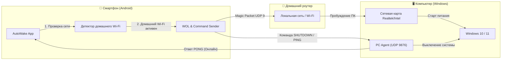

# ⚡ AutoWake

<p align="center">
  
  
  
  
  <a href="https://github.com/Overskill52/AutoWake/releases/latest/download/AutoWakePC.apk"></a>
</p>

**AutoWake** — это легковесный и функциональный комплекс для удаленного включения, выключения и мониторинга компьютера под управлением Windows прямо со смартфона на Android.

Включает в себя нативное **Android-приложение** с поддержкой динамических тем Material You и **фонового агента для Windows**, не требующего прав суперпользователя и работающего бесшумно в фоне.

---

## 🌟 Возможности

* ⚡ **Wake-on-LAN (WOL):** Включение выключенного компьютера отправкой Magic Packet в один клик.
* 🏠 **Умная привязка к домашнему Wi-Fi:** Приложение включает ПК автоматически только при подключении к твоей домашней сети. В кафе, на работе или в гостях телефон не будет зря слать сигналы.
* 🔄 **Авто-вычисление Broadcast IP:** Приложение на лету сканирует сетевой интерфейс и само находит актуальный широковещательный адрес. Даже если роутер перезагрузится или сменит подсеть, сигнал дойдет без ручной перенастройки.
* 🛑 **Удаленное выключение и сон:** Корректное завершение работы Windows (`shutdown /s /t 2`) или переход в спящий режим прямо с телефона.
* ⏱️ **Таймер выключения с отменой:** Возможность выключить ПК через 30 минут, 1, 1.5, 2, 3, 4 часа или указать своё точное время в минутах. Отображение времени срабатывания в реальном времени и кнопка быстрой отмены.
* 🟢 **Мониторинг статуса ПК:** В реальном времени отображает состояние: `🟢 ПК включен (в сети)` или `⚪ ПК выключен`.
* 🎨 **Material You / Themed Icons (Android 13+):** Адаптивная векторная иконка автоматически окрашивается в цвета обоев рабочего стола.
* 🪶 **Невесомый агент для Windows:** Потребляет 0% процессора и несколько мегабайт ОЗУ, стартует невидимо вместе с Windows.

---

## 📐 Архитектура системы



---

## 🚀 Быстрый старт

### Шаг 1. Настройка Windows (на ПК)

1. **Клонируйте репозиторий:**
   ```bash
   git clone https://github.com/Overskill52/AutoWake.git
   cd AutoWake
   ```

2. **Отключите "Быстрый запуск" (Fast Startup):**
   * Запустите файл `disable_fast_startup.bat` от имени администратора.
   *(В Windows 10/11 быстрый запуск полностью обесточивает сетевую карту при выключении, что мешает приему Magic Packet).*

3. **Разрешите порт в брандмауэре Windows:**
   * Запустите `fix_firewall.bat` от имени администратора.
   *(Скрипт откроет входящий UDP-порт 9876 для связи с телефоном и переведет домашнюю сеть в доверенный режим).*

4. **Добавьте агента выключения в автозагрузку:**
   * Запустите `install_autostart.bat`.
   * Агент запустится в фоновом режиме без окон и будет автоматически стартовать вместе с Windows.

---

### Шаг 2. Настройка BIOS (на ПК)

При перезагрузке компьютера войдите в BIOS (клавиша `Del` или `F2`):
1. **Wake-on-LAN:**
   * **MSI:** `Settings` ➡️ `Advanced` ➡️ `Wake Up Event Setup` ➡️ `Resume By PCI-E Device` ➡️ **[Enabled]**.
   * **ASUS:** `Advanced` ➡️ `APM Configuration` ➡️ `Power On By PCI-E` ➡️ **[Enabled]**.
   * **Gigabyte:** `Settings` ➡️ `Platform Power` ➡️ `Wake on LAN` ➡️ **[Enabled]**.
   * **ASRock:** `Advanced` ➡️ `ACPI Configuration` ➡️ `PCIE Devices Power On` ➡️ **[Enabled]**.
2. **Энергосбережение (ErP):**
   * Найдите пункт **ErP Ready** (или `Deep Sleep`) и выставьте **[Disabled]**, чтобы сетевой порт оставался запитанным в выключенном состоянии.
3. Сохраните настройки (`F10`).

---

### Шаг 3. Установка и настройка приложения на телефоне

1. **Скачайте APK:**
   * [Прямая ссылка на APK (v1.9)](https://github.com/Overskill52/AutoWake/releases/latest/download/AutoWakePC.apk) или со страницы [Releases](https://github.com/Overskill52/AutoWake/releases).
   * Либо запустите на ПК `download_app.bat` и отсканируйте камерой телефона QR-код.
2. **Настройте приложение:**
   * **MAC-адрес:** введите физический адрес сетевой карты вашего ПК (узнать в Windows: команда `getmac` или `ipconfig /all`).
   * **Домашний Wi-Fi:** нажмите кнопку **«🔍 Текущий»** рядом с полем Wi-Fi (потребуется стандартное системное разрешение на геопозицию для чтения имени сети).
   * **IP адрес:** укажите локальный IP вашего ПК (например, `192.168.1.100`) для проверки статуса онлайна и выключения.
   * Нажмите **«Сохранить настройки»**.
   * Переведите тумблер **«Авто-включение»** в активное положение.

---

## 🛠️ Утилиты в комплекте

В репозитории содержатся автономные Python-скрипты для диагностики и управления:

* **`pc_agent.py`** — легковесный UDP-сервер на порту `9876`, обрабатывающий команды `PING`, `SHUTDOWN`, `SHUTDOWN_TIMER`, `CANCEL_SHUTDOWN` и `SLEEP`.
* **`send_wol.py`** — консольный скрипт отправки Wake-on-LAN пакетов с любого компьютера:
  ```bash
  python send_wol.py 00:11:22:33:44:55 192.168.0.255 9
  ```
* **`wol_listener.py`** — сниффер для отладки и проверки дохождения UDP-пакетов через роутер:
  ```bash
  python wol_listener.py 9
  ```
* **`run_download_server.py`** — локальный HTTP-сервер с автоматической генерацией ASCII QR-кода в терминале для быстрой раздачи APK по Wi-Fi.
* **`build_apk.py`** — автономный скрипт сборки Android APK без Gradle и тяжелых IDE (требует только установленный Android SDK и JDK 17).

---

## 🔒 Безопасность

* **Изоляция:** Связь между телефоном и ПК происходит исключительно внутри домашней локальной сети через ваш личный Wi-Fi роутер.
* **Аппаратный NAT:** Порт агента закрыт от интернета сетевым экраном роутера.
* **Фиксированный набор команд:** Агент принимает только жестко заданные текстовые команды (`PING`, `SHUTDOWN`, `SHUTDOWN_TIMER`, `CANCEL_SHUTDOWN`, `SLEEP`). Возможность передачи файлов или исполнения стороннего кода полностью исключена архитектурно.

---

## 📄 Лицензия

Проект распространяется под открытой лицензией [MIT](LICENSE).
